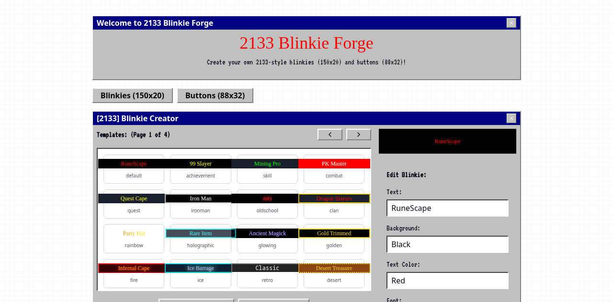

# 2133 Blinkie & Button Generator  
**still blinking in the ruins.**




[→ visit the generator](https://numbpill3d.github.io/2133-blinkie-button-forge/)  


## what is this?

a chaotic, expressive little tool for making blinkies, 88x31 buttons, microbanners, and pixel tags — no photoshop, no code.  
made for neocities, webrings, cyber shrines, forums, zines, and indie homepages across the new old web.

you can:
- generate custom text
- pick fonts, backgrounds, borders, glitter overlays
- export blinkies and buttons instantly
- remix the tool to suit your own subculture or project

built entirely in html, css, and js — zero backend. host it anywhere, modify it freely.

---

## live demo

🌐 **[Launch the Generator](https://numbpill3d.github.io/2133-blinkie-button-forge/)**  
(use it directly in-browser, no install needed)

---

## features

- 🧬 multiple templates: blinkies, 88x31, badges  
- 🎨 custom text, background, font, size, border  
- ✨ optional glitter overlays and animation  
- 💾 export to .gif or .png  
- 🛠️ entirely client-side — portable, modifiable, offline-friendly

---

## how to use

1. visit the live link above  
2. fill out the form with your custom text, colors, and style  
3. click "generate"  
4. right-click > save your creation, or embed it directly into your site

---

## how to self-host

clone this repo and open `index.html` in your browser, or deploy it to GitHub Pages:

```bash
git clone https://github.com/yourusername/2133-blinkie-generator.git
cd 2133-blinkie-generator

```
